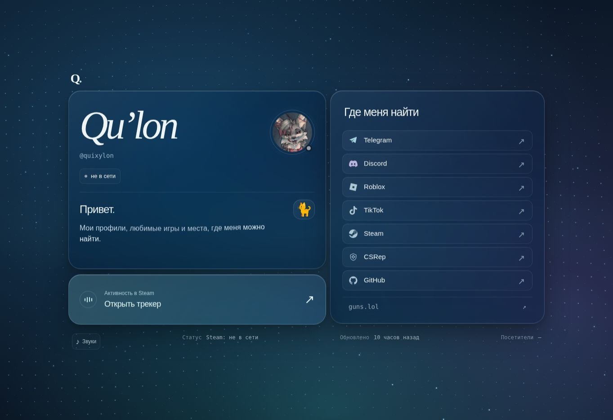
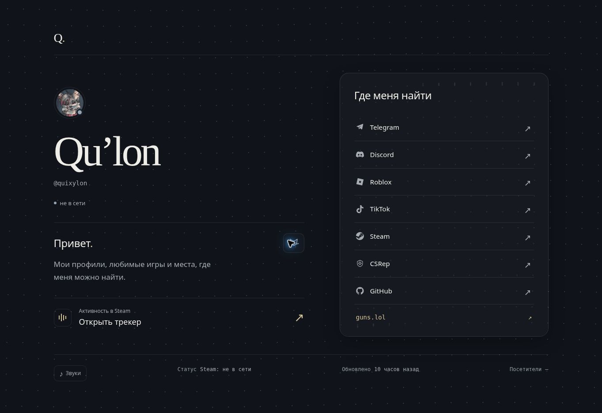
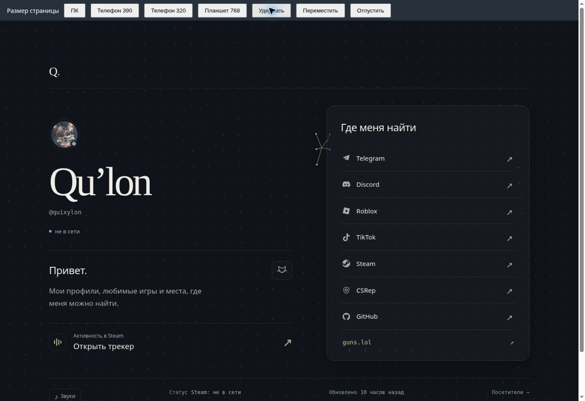
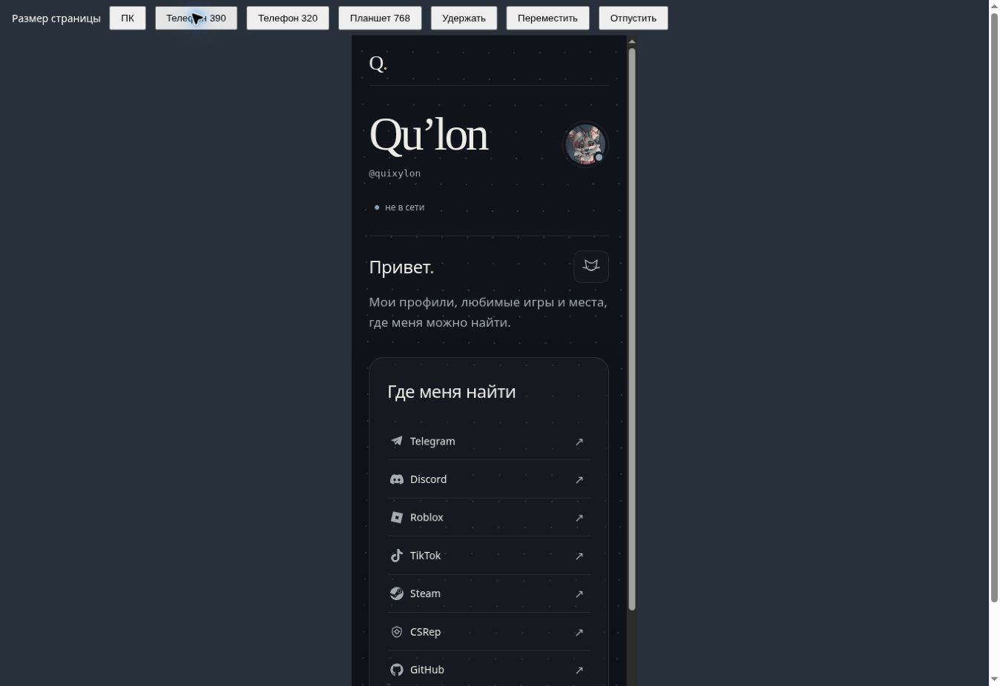

# Dark Glass — реализация и проверка

Рабочая ветка: `codex/dark-glass-pointer`, исходный `main`: `df730e72c45fc1ddb030c744ef251cddc7bf0414`. Работа выполнена 2 ноября 2026; идентификатор версии интерфейса — `dark-glass-20261103`.

## Краткий аудит

Актуальный сайт: `projects/steam-status-tracker/public/index.html`, обычные HTML/CSS/JS без сборки и npm-зависимостей. Фон и события — `assets/motion.js`, стекло — `assets/glass.js`, подключение поверхностей — `assets/ui.js`. Другие HTML-страницы являются совместимыми перенаправлениями. Файлов AGENTS.md внутри репозитория не обнаружено. Прочитаны README и workflow GitHub Pages.

До изменения нажатие создавало ограниченную по времени сеть связей между точками, расходящуюся от начального места нажатия. Она не соответствовала жесту удержания. Однотипные стеклянные панели, наклоны, парение, световые поля и цветные заливки конкурировали с содержанием.

После изменения профиль имеет открытую левую колонку и один оптический список ссылок справа. Графит, тёплый приглушённый акцент, крупное имя с засечками, спокойная иерархия. На телефоне блоки идут последовательно. Статусы, тексты, адреса, Steam-данные, поиск, история, звук и реакция кота сохранены. Биографические сведения не добавлялись. Старые волны/искры нажатия удалены.

## Материал и источники

Применён [Unslop](https://github.com/heydamir/unslop), включая [SKILL.md](https://github.com/heydamir/unslop/blob/main/skills/unslop/SKILL.md) и связанные материалы signs/tokens/visuals/refs. **Атрибуция: Unslop by Damir Sokolovsky (@heydamir), [CC BY 4.0](https://creativecommons.org/licenses/by/4.0/).** Принципы адаптированы: меньше повторяющихся контейнеров, осмысленная типографическая иерархия, сдержанный цвет, проверка в браузере. Атрибуция не означает одобрение этой реализации автором Unslop.

Визуальный ориентир — [Premium Dark Glass](https://unslop.site/site/premium-dark-glass), его agent brief и интерактивное [preview](https://unslop.site/view/premium-dark-glass). Изучены пропорции, глубина, тонкие границы и сочетание засечек с нейтральным интерфейсным шрифтом. Содержимое, фирменные материалы и HTML шаблона не копировались. Кнопка Copy HTML не предоставила текст через доступный буфер обмена; это не выдаётся за просмотр полного исходного HTML.

Технические кандидаты проверены до выбора:

| Источник | Что проверено | Решение |
| --- | --- | --- |
| [Apple — Meet Liquid Glass](https://developer.apple.com/videos/play/wwdc2025/219/) | Поведение материала, разделение контента и навигационного слоя, читаемость | Применены оптические принципы; идентичность нативному материалу не заявляется |
| [rukkiecodes/liquid-glass](https://github.com/rukkiecodes/liquid-glass) | README и `core/refraction.ts`, расчёт смещения по нормалям; ограничения SVG backdrop-filter | README заявляет MIT, отдельный LICENSE по проверенному пути не найден. Не включён как зависимость, исходники не копировались |
| [tomagranate/liquid-glass](https://github.com/tomagranate/liquid-glass) | README, MIT LICENSE (Copyright 2026 Tom), ARCHITECTURE.md, WebGL2 backend | Полезный ориентир для независимого фонового слоя и fallback; библиотека не добавлена, исходники не копировались |

Сохранена и доработана уже существовавшая в проекте архитектура одного WebGL 1 контекста. Оптическое смещение теперь выводится из нормали скруглённого бортика, закона преломления и конечной толщины слоя; середина плоская. Стандартная математика реализована непосредственно в проекте. Ширина бортика 28 CSS px, толщина 20 px, IOR 1.46. GPU-ветка добавляет мягкую диффузию и отражения. Размер backing store учитывает DPR и ограничение в 4 млн пикселей.

Реальный canvas точек и линий передаётся как текстура **после отрисовки текущего кадра**. Никакого захвата произвольного DOM или застывшего скриншота нет. Панели получают локальные canvas с актуальными координатами относительно viewport; текст и иконки находятся выше и не фильтруются. На прокрутке/resize координаты обновляются.

Без WebGL используется обычный SVG `filter`/`feDisplacementMap` на живой копии фонового canvas, а не SVG `backdrop-filter`. Карта преломления строится по размеру панели, хранится до resize и получает новый ID после пересоздания, чтобы не переиспользовать закэшированную карту. Содержимое копии обновляется в том же цикле фона. SVG-вариант проще по отражениям и диффузии, но действительно искажает текущие точки/линии. Если фильтры недоступны, остаётся тонированная читаемая поверхность; усиленный контраст и уменьшение прозрачности отключают оптический слой.

## Жест и производительность

`POINTER_LINKS`: до 5 существующих ближайших точек в радиусе 180 CSS px, рост 200 мс, гистерезис 12 px. На каждый кадр начало равно текущему указателю, конец — текущей позиции выбранной точки. За пределами радиуса связей нет. При смене соседей сохраняется предпочтение уже выбранным точкам. Отпускание очищает состояние, следующий кадр не содержит линий.

Pointer Events обрабатывают `pointerup`, `pointercancel`, `lostpointercapture`, отсутствие левой кнопки в `buttons`, выход из окна, `blur`, `pagehide`, скрытие вкладки и прокрутку. Контролы и текст исключены из начала жеста. Touch не захватывается программно и не отменяет default scrolling. Нет таймеров или новых обработчиков на каждое нажатие. Один цикл фона ограничен 60 fps; скрытая вкладка его останавливает. Reduced motion оставляет статичный фон с мгновенными связями при удержании.

## Выполненная проверка

- `npm run check`: валидатор 29 публичных файлов и 3 скриптов; 31 тест проходит. Проверены данные, маршрутизация, обновление Steam, прямое направление и рост линий, удержание больше 3 секунд, движение, радиус/лимит/гистерезис, быстрые повторные нажатия, отмены, blur, hidden, захват, контролы/текст, touch без capture, reduced motion, единственный цикл, resize и HiDPI-бюджет. SVG-карта проверена на ненулевое смещение у края, плоский центр, живой источник и инвалидацию при resize. WebGL lifecycle и проекция проверены с mock-контекстом, а не реальным GPU.
- В доступном Chromium запущен сайт, проверены профиль и трекер, вкладка Steam, поиск `Rust`, кнопка кота, отсутствие запуска фона от контролов. Данные/скрипты/стили загружены под `/AI/`; поиск действительно отфильтровал каталог.
- Визуально проверены ширины 320, 390, 768 и desktop (~1360). Мобильные ширины — CSS viewport внутри dev iframe, **не эмуляция физического телефона**. Исправлены обнаруженные наложения ссылок на 768 и выход footer за ширину на 320. `scrollWidth === clientWidth` после исправлений на 320/390/768.
- Dev-панель `/__preview` позволяет воспроизвести удержание, перемещение и отпускание синтетическими Pointer Events. В браузере визуально проверены 5 связей, смена источника при движении, очистка до 0, а также преломление движущейся сетки и связей на краю. Эти события не заменяют тесты физической мыши/сенсора.
- После окончательной перезагрузки ошибок приложения не обнаружено. В журнале среды остались ошибки её расширения и исправленная ранее синтаксическая ошибка dev-панели; к итоговой версии они не относятся.

## Ограничения проверки

В доступном облачном Chromium WebGL-контекст не создаётся; визуально проверен SVG fallback. GPU-ветка проверена по коду и unit tests, но не отрисована реальным GPU здесь. Firefox и WebKit недоступны, поэтому кроссбраузерная визуальная проверка не заявляется. Использованы стандартные Canvas2D/SVG filter primitives и предусмотрен простой визуальный fallback, однако реальную совместимость этих движков ещё нужно проверить. Физические touch scrolling, отмена системного жеста, отпускание вне окна ОС и настоящий HiDPI экран не проверены; логика покрыта тестами. Запись видео интерфейса в доступном инструменте не предоставлена.

Перед merge желательно открыть эту ветку в Firefox, Safari/iOS и Chromium с GPU: удержать в свободной области, провести вдоль стекла, отпустить вне окна, сменить вкладку, прокрутить touch, проверить 1×/2× DPR и reduced motion. Это оставшаяся проверка, а не выполненный пункт.

PR не публикует сайт: workflow для `pull_request` запускает только validate. Изменения не сливаются в main и Pages deployment не запускался.

## Снимки

До изменения:

После:

Удержание рядом со стеклом (синтетический указатель; источник слева от панели):

Мобильная компоновка:

